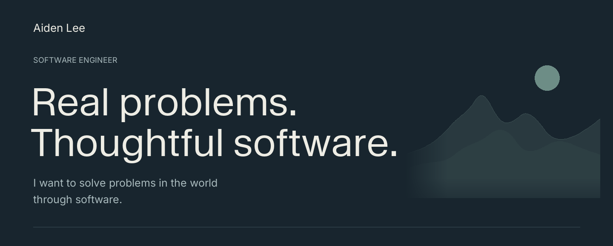

<table>
<tr>
<td width="65%" valign="middle">

### Hi, I'm Aiden.

안녕하세요, 이유민입니다.  
세상의 문제를 소프트웨어 기술로 해결하고 싶습니다.  
문제를 이해하고, 아이디어를 만들고, 해결 방법을 찾아갑니다.

</td>
<td width="35%" valign="middle">

</td>
</tr>
</table>

### On my GitHub

- **[side-toolkit ↗](https://github.com/AidenLee0408/side-toolkit)**
- **[AndroidSimple ↗](https://github.com/AidenLee0408/AndroidSimple)** — 간단한 안드로이드 프로젝트 모음

---

이유민 / Aiden Lee · <a href="mailto:aiden020408@gmail.com">Let's talk ↗</a>
