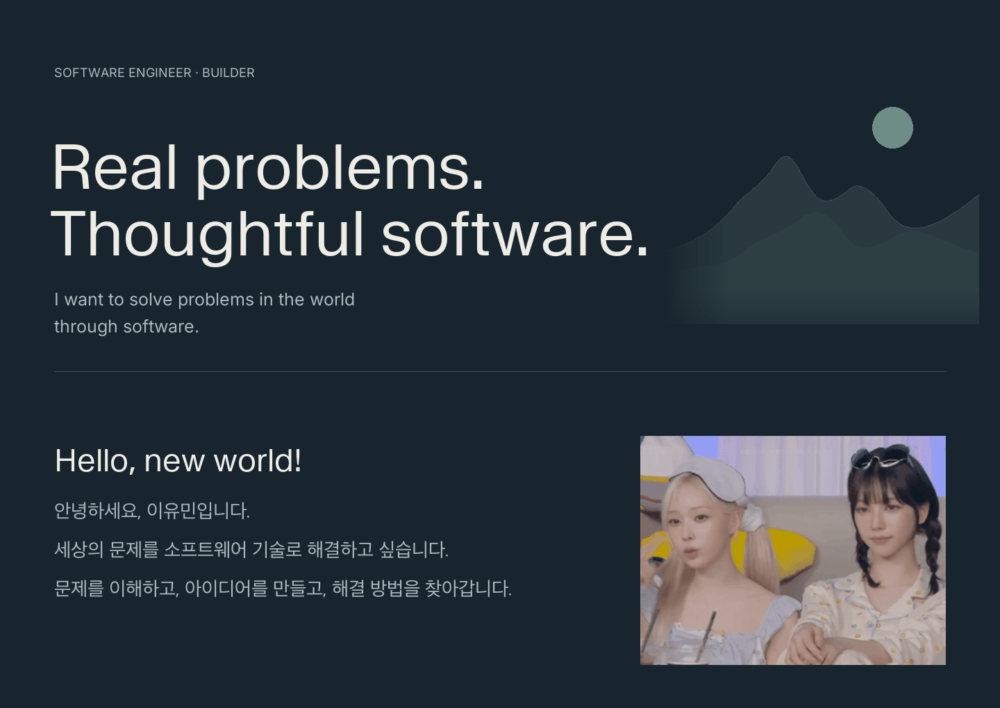

<picture><source media="(max-width: 600px)" srcset="assets/profile-panel-compact-mobile.gif"></picture><a href="https://github.com/AidenLee0408/side-toolkit"><picture><source media="(max-width: 600px)" srcset="assets/profile-toolkit-compact-mobile.png"></picture></a><a href="https://github.com/AidenLee0408/AndroidSimple"><picture><source media="(max-width: 600px)" srcset="assets/profile-android-compact-mobile.png"></picture></a><a href="mailto:aiden020408@gmail.com"><picture><source media="(max-width: 600px)" srcset="assets/profile-contact-compact-mobile.png"></picture></a>

